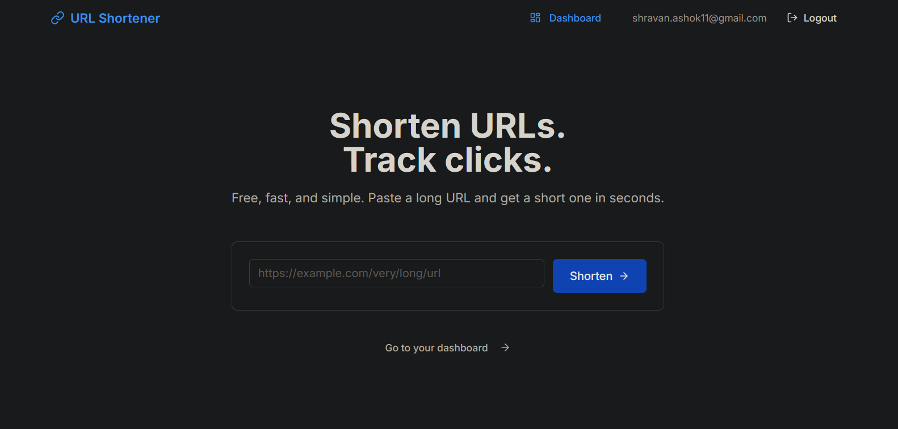

# URL Shortener UI

A responsive React 19 frontend for the URL Shortener API. 

🌐 **Live App:** [https://url-shortener-ui-flax.vercel.app](https://url-shortener-ui-flax.vercel.app)  
🔌 **API Repo:** [UrlShortener](https://github.com/ShravanAshok16/UrlShortener)

<!-- Add your screenshot here! Make sure to upload it to the public folder of your repo -->


---

## 📌 Current Status

**Phase:** Production Ready
**Progress:** `[██████████] 100%`

### ✨ Features
- **Authentication:** JWT-based login and registration with session persistence.
- **Dashboard:** Paginated table (desktop) and cards (mobile) for managing links.
- **Batch Actions:** Multi-select checkboxes with optimistic batch deletion.
- **Search & Sort:** Debounced search input with server-side sorting.
- **UX:** Optimistic UI for deletes, loading skeletons, empty states, and error handling.
- **Accessibility:** WCAG 2.1 AA compliant, fully keyboard navigable.
- **Performance:** Lighthouse scores of 99 (Desktop) and 93 (Mobile).

---

## 🗓️ Daily Log

### 2026-10-19 (Day 15 — Final Polish & Retrospective)
- Added `SECURITY.md` detailing frontend and backend security decisions (CSP, XSS protection, etc.).
- Finalized README with live links, screenshots, and project documentation.
- Ran final Lighthouse audits.
- Wrote project retrospective.

### 2026-10-18 (Day 14 — Deployment & Security)
- Deployed frontend to Vercel.
- Configured `VITE_API_URL` environment variable for production.
- Created `vercel.json` with strict security headers (CSP, HSTS, X-Frame-Options).
- Fixed production CORS issues and routing conflicts between Render and Vercel.
- Successfully tested the full live E2E flow (register → shorten → click → dashboard → delete).

### 2026-10-17 (Day 13 — Dashboard & Polish)
- Built React Query hooks (`useLinks`, `useDeleteLink`, `useBatchDeleteLinks`).
- Created responsive `LinkTable` (desktop) and `LinkCard` (mobile) components.
- Implemented optimistic UI for instant deletion feedback.
- Added debounced search (`useDebounce`), sorting, and pagination.
- Added batch selection with floating action bar.

### 2026-10-16 (Day 12 — Auth Flow)
- Split `useAuth` into context/provider for Fast Refresh compatibility.
- Implemented `ProtectedRoute` with return-to redirect.
- Built Landing, Register, Login, and Dashboard (placeholder) pages.
- Added `auth:unauthorized` event handling for expired sessions.

### 2026-10-15 (Day 11 — Setup)
- Initialized Vite + React 19 + TypeScript project.
- Configured Tailwind CSS v4 with design tokens.
- Built Axios API client with interceptors.
- Created initial UI primitives (`Button`, `Input`, `Card`).

---

## 🏗️ Project Structure
```
url-shortener-ui/
├── src/
│   ├── api/                    # HTTP layer
│   │   ├── client.ts           # axios instance + interceptors
│   │   ├── auth.ts             # register, login
│   │   ├── links.ts            # createLink, listLinks, deleteLink
│   │   └── types.ts            # DTOs matching backend
│   ├── components/
│   │   ├── ui/                 # Button, Input, Card
│   │   └── layout/             # Header, Footer, Container
│   ├── features/
│   │   ├── auth/               # components + hooks for auth
│   │   ├── links/              # components + hooks for links
│   │   └── landing/            # landing page components
│   ├── hooks/                  # shared hooks
│   ├── lib/                    # utils (cn, format, validation)
│   ├── pages/                  # route-level components
│   ├── styles/
│   │   └── globals.css         # Tailwind directives + theme
│   └── types/                  # global types
├── public/
├── .env.example
├── .env.local                  # gitignored
├── index.html
├── package.json
├── tsconfig.json
├── vite.config.ts
└── README.md
```

### Layer Rules
- **`api/`**: The ONLY place that talks to the backend.
- **`components/ui/`**: Dumb primitives, no domain knowledge.
- **`features/`**: Self-contained modules (components + hooks + types).
- **`pages/`**: Thin wrappers that wire features together.

---

## 🔌 API Integration

### Base URL
From `VITE_API_URL` in `.env.local`:
- Local: `http://localhost:5029`
- Production: `https://url-shortener-api-edae.onrender.com`

### Endpoints used
| Method | Path | Purpose |
|---|---|---|
| `POST` | `/api/Auth/register` | Create account, returns JWT |
| `POST` | `/api/Auth/login` | Authenticate, returns JWT |
| `POST` | `/api/Links` | Create short link (deduplicates existing user URLs) |
| `GET` | `/api/Links` | List user's links (paginated, filterable, sortable) |
| `DELETE` | `/api/Links/{id}` | Soft-delete a link |

### Authentication
- JWT is stored in `localStorage` (key: `url-shortener-token`).
- Attached automatically via axios request interceptor.
- `401` responses trigger a global `auth:unauthorized` event, clearing the session and redirecting to login.

---

## 🛠️ Tech Stack

- **React 19** + **TypeScript** (strict mode)
- **Vite** (build tool)
- **Tailwind CSS v4** (design tokens via `@theme`)
- **TanStack Query v5** (server state, caching, optimistic updates)
- **React Router v7** (routing)
- **Axios** (HTTP client)
- **Sonner** (toast notifications)
- **Lucide React** (icons)

---

## 🚀 Setup

### Prerequisites
- Node.js 20+
- Backend running locally or on Render

### 1. Clone & Install
```bash
git clone https://github.com/ShravanAshok16/url-shortener-ui.git
cd url-shortener-ui
npm install